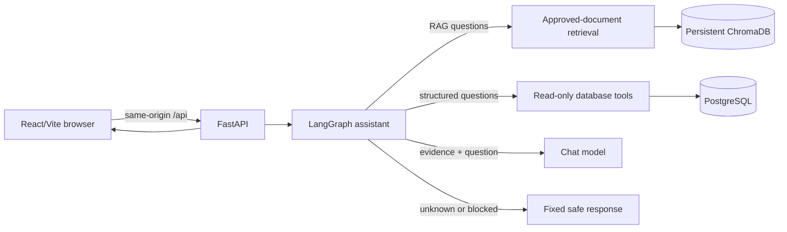

# Architecture

## System Overview

The application answers student questions from approved Markdown documents or structured PostgreSQL records. The language model does not choose arbitrary tools or act as a source of academy facts.

For local development the browser runs on Vite and Vite proxies `/api` to FastAPI. In a single-service deployment FastAPI serves the built `frontend/dist` files and API routes on the same origin. PostgreSQL and ChromaDB are backing services; ChromaDB persists to the configured local directory/volume.

## Request Flow

1. FastAPI validates `message` and optional `conversation_id`.
2. Group 2 validates/normalizes the turn, loads bounded process-local history, screens direct injection attempts, and asks for a Pydantic-validated intent/entity/time-sensitivity classification before routing. If structured classification fails, a conservative deterministic classifier is used.
3. A fixed policy maps stable public facts to approved RAG, current schedules to the live schedule tool, private/unavailable data to a safe support handoff, and genuinely vague requests to clarification. The classifier cannot choose arbitrary tools.
4. RAG starts with the original retrieval query and may add bounded spelling/phrase variants only after RAG has been selected. It merges and ranks approved excerpts; the original user message remains the answer-generation question.
5. The graph requires non-empty approved evidence before it asks the model to generate academy-specific text. Safety, clarification, unavailable, and unknown routes do not call unrelated tools.
6. Database tools and public course endpoints are disabled unless `DATABASE_DATA_VERIFIED=true`; this must only be set after current authorized production records have been loaded and reviewed.
7. FastAPI returns `answer`, `sources`, and `conversation_id`; the browser renders only that response.

## Ownership Boundaries

| Area | Responsibility |
| --- | --- |
| `backend/rag/`, `knowledge_base/` | Registry approval, document loading, embeddings, Chroma, retrieval and citations. |
| `backend/agents/`, `backend/ai/` | Routing, graph state, safety, memory, grounding prompts and response generation. |
| `backend/database/`, `backend/tools/` | PostgreSQL schema/session setup, synthetic development seed, read-only tools. |
| `backend/api/` | HTTP validation, dependency injection, service lifecycle, error responses and static frontend serving. |
| `frontend/` | Chat UI, same-origin API client, conversation identifier and display of backend answers/sources. |
| `tests/`, `docs/`, `scripts/` | Shared acceptance cases, setup, test execution and deployment instructions. |

## Runtime Boundaries

- `DATABASE_URL`, `OPENAI_API_KEY`, model names and vector credentials belong in runtime environment settings, never source control.
- `conversation_id` identifies history; it is not authentication or authorization.
- Conversation history is currently in process memory and is lost on restart or when requests reach another replica.
- Seed records are synthetic. They must not be represented as actual academy courses, instructors, schedules, or students.
- `DATABASE_DATA_VERIFIED` defaults to false. It is an operator assertion, not an automatic data-quality check; do not enable it for synthetic or stale records.
- Chroma persistence requires a persistent disk/volume in hosted environments. An ephemeral container filesystem loses the index on redeploy.
- Retrieval similarity is not proof of answer support. The graph gates on approved evidence, while the model prompt and tests reinforce grounding; the model remains probabilistic.
